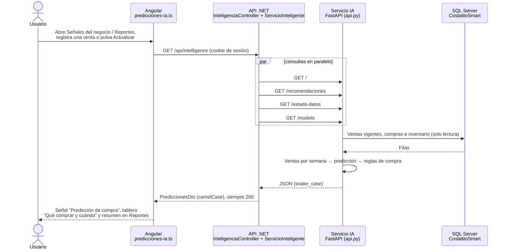

# Integración del servicio de Inteligencia Artificial — evidencias

Este documento muestra que el servicio de IA está **integrado y en uso**, no solo documentado. Sigue la cadena que pide la entrega:

**Aplicación → solicitud al servicio de IA → procesamiento → respuesta → uso de la respuesta en la aplicación.**

Los datos son los de la base de demostración (historial del 10/09/2026 al 17/11/2026), consultados el 18/11/2026.

---

## 1. Función de la IA en Costalito Smart

El dueño del granero decide todos los días qué pedir a cada proveedor. Si pide tarde, se queda sin leche o sin pan. Si pide de más, inmoviliza dinero y la mercancía perecedera se vence.

El servicio de IA **predice la demanda de la semana de cada producto** a partir de las ventas registradas y, con esa predicción, las existencias, lo que está en camino y los días que tarda el proveedor, **sugiere cuándo y cuánto comprar**, explicando el porqué. Está ligado directamente al propósito del proyecto: inventario, compras y proveedores.

| Pieza | Responsable | Qué hace |
|---|---|---|
| Predicción | Red neuronal TensorFlow (`Dense 8 → 4 → 1`), o el promedio de 4 semanas si la red no lo supera | Unidades que se venderán en la semana |
| Decisión | Reglas de `servicio-inteligente/demanda.py` | Punto de pedido, cuándo pedir, cuánto pedir y urgencia |

## 2. Componentes y flujo



| Capa | Archivo | Rol |
|---|---|---|
| Angular | `frontend/src/app/core/predicciones-ia.ts` | Pide `/api/intelligence` y guarda el estado |
| Angular | `frontend/src/app/core/datos-granero.ts` | Convierte las urgencias en la señal "Predicción de compra" |
| Angular | `frontend/src/app/pages/inteligencia/componentes/predicciones-compra/` | Tablero "Qué comprar y cuándo" |
| Angular | `frontend/src/app/pages/reportes/` y `core/reporte.ts` | Resumen de la IA en Reportes y en el CSV exportado |
| .NET | `backend/Costalito.Api/Controllers/InteligenciaController.cs` | Ruta `GET /api/intelligence` (protegida con sesión) |
| .NET | `backend/Costalito.Api/Services/ServicioInteligente.cs` | Cliente HTTP del servicio de IA, une las respuestas y maneja fallos |
| IA | `servicio-inteligente/api.py` | Rutas de predicción y recomendación |
| IA | `servicio-inteligente/fuente_sql.py` | Lectura de SQL Server |
| IA | `servicio-inteligente/demanda.py` | Semanas completas, quincena y reglas de compra |
| IA | `servicio-inteligente/entrenar_modelo.py` | Entrenamiento y evaluación contra la línea base |

## 3. Antes y después

| | Antes (commit `0abb7d2`) | Ahora |
|---|---|---|
| Datos de la IA | CSV sintéticos con fechas desde noviembre de 2025 | Tablas `Ventas`, `DetallesVenta`, `Compras` y `Productos` de SQL Server |
| Comunicación | Ninguna: Angular y .NET no llamaban al servicio | Angular → `GET /api/intelligence` → .NET → FastAPI |
| Señales del negocio | Reglas fijas en el navegador ("existencias ≤ mínimo"). El texto decía: *"En la siguiente fase, se alimentará desde la API."* | Señal "Predicción de compra" y tablero por producto con demanda prevista, días de entrega y explicación |
| Reportes | Cifras escritas a mano y botón de exportar sin acción | Indicadores calculados con las ventas y CSV con las predicciones de la IA |
| Si la IA falla | No aplicaba | La aplicación sigue funcionando y explica qué hacer |
| Modelo | Entrenado con datos sintéticos | Entrenado con las ventas de la base, y evaluado contra el promedio |

La diferencia práctica: la regla anterior solo avisaba cuando un producto **ya** había bajado del mínimo. La IA mira **a qué ritmo se vende** y **cuánto tarda el proveedor**, así que avisa antes. Por ejemplo, el aceite tiene 24 unidades y un mínimo de 18, así que la regla anterior no decía nada. La IA prevé 22 por semana con 2 días de entrega e indica pedir hoy.

## 4. Evidencia: la aplicación se comunica con el servicio

Registro de la API .NET al abrir la aplicación con una sesión iniciada:

```text
info: System.Net.Http.HttpClient.IServicioInteligente.ClientHandler[100]
      Sending HTTP request GET http://127.0.0.1:8000/
info: System.Net.Http.HttpClient.IServicioInteligente.ClientHandler[100]
      Sending HTTP request GET http://127.0.0.1:8000/recomendaciones
info: System.Net.Http.HttpClient.IServicioInteligente.ClientHandler[100]
      Sending HTTP request GET http://127.0.0.1:8000/estado-datos
      Received HTTP response headers after 86.8834ms - 200
      Received HTTP response headers after 134.9666ms - 200
      End processing HTTP request after 136.7215ms - 200
```

Sin sesión, la ruta está protegida como el resto de la API:

```text
GET http://localhost:5257/api/intelligence
401 {"error":"Inicia sesión para continuar.","status":401}
```

Con el servicio de IA apagado, la API responde igual y la pantalla lo informa:

```json
{ "disponible": false,
  "mensaje": "El servicio inteligente no responde en http://127.0.0.1:8000. Inícialo desde la carpeta servicio-inteligente con 'uvicorn api:app' y vuelve a consultar." }
```

## 5. Evidencia: qué recibe, cómo procesa y qué responde

### Estado de los datos (`GET /estado-datos`)

```json
{"primera_venta":"2026-09-10","ultima_venta":"2026-11-18","productos_con_ventas":16,
 "semanas_completas":9,"primera_semana_completa":"2026-09-14","semanas_necesarias":8,"se_puede_entrenar":true}
```

### Modelo entrenado (`GET /modelo`)

```json
{"version":"20261118-140836","productos_usados":14,
 "ejemplos":{"entrenamiento":42,"validacion":14,"prueba":14},"epocas_entrenadas":55,
 "mae_red_neuronal":7.12,"mae_promedio_movil":6.04,"usar_red":false}
```

La red se entrenó con las ventas de la base, pero en la prueba se equivocó más que el promedio de 4 semanas (7,12 contra 6,04 unidades por semana). El servicio lo detecta y predice con el promedio hasta que, con más semanas registradas, la red lo supere.

### La misma pregunta con datos distintos (`POST /recomendar-compra`)

Leche entera 1 L, con ventas de las últimas 4 semanas de 74, 73, 61 y 79 unidades y un mínimo de 10:

| Escenario | Entrada | Respuesta del servicio |
|---|---|---|
| A | quedan **7** | **alta**, comprar ahora, 85 unidades: *"Ya se alcanzó el punto de pedido: compra hoy unas 85 unidades…"* |
| B | quedan **60** | **media**, pedir en 3 días, 72 unidades: *"Alcanza para unos 6 días: haz el pedido en 3 días…"* |
| C | quedan 60, y las ventas suben a 90, 95, 100 y 110 | **media**, pedir en **2** días, **99** unidades: *"Se esperan unas 99 unidades por semana…"* |

El servicio no devuelve una cifra fija: recalcula según el inventario y el ritmo de ventas. Los días de entrega (1 día para la leche) los aprende de las compras registradas en la base.

### Recomendaciones para todo el inventario (`GET /recomendaciones`)

| Producto | Urgencia | Cuándo | Cantidad | Prevista/semana | Existencias |
|---|---|---|---:|---:|---:|
| Leche entera 1 L | alta | ahora | 85 | 71,8 | 7 |
| Pan tajado | alta | ahora | 40 | 35,5 | 12 |
| Aceite vegetal 1 L | alta | ahora | 23 | 22,0 | 24 |
| Queso campesino 500 g | media | en 3 días | 14 | 13,2 | 14 |
| Huevos AA x 30 | media | en 3 días | 23 | 22,8 | 35 |
| Café de Huila 250 g | media | en 3 días | 15 | 14,2 | 26 |
| Panela cuadrada | media | en 4 días | 22 | 22,0 | 40 |
| Arroz Diana 500 g | media | en 5 días | 53 | 52,5 | 85 |
| Gaseosa 1,5 L | media | en 6 días | 36 | 35,2 | 30 |
| Papel higiénico x 4 | baja | en 11 días | 17 | 16,5 | 20 |
| Frijol cargamanto 500 g | baja | en 12 días | 22 | 21,8 | 32 |
| Jugo de naranja 1 L | baja | en 17 días | 14 | 13,2 | 22 |
| Sal 500 g | baja | en 20 días | 11 | 11,0 | 50 |
| Jabón líquido 1 L | baja | en 24 días | 6 | 5,2 | 17 |

*Sin predicción todavía (menos de 4 semanas de ventas): Gansito, Chocoramo.*

## 6. Evidencia: uso de la respuesta en la aplicación

| Pantalla | Qué muestra con la respuesta de la IA |
|---|---|
| **Señales del negocio** | Señal *"Predicción de compra: Toca pedir Leche entera 1 L hoy…"*, que cuenta en el total de prioridades |
| **Señales del negocio → Qué comprar y cuándo** | Resumen (comprar hoy 3, esta semana 6, cubiertos 5), método usado y por qué, y un renglón por producto con sello de urgencia, acción, barras de 4 semanas frente a la prevista y explicación |
| **Mi jornada** | La misma señal entre las prioridades del día |
| **Reportes** | *"Hay que pedir hoy 3 productos: Leche entera 1 L, Pan tajado, Aceite vegetal 1 L"* y la tabla completa en el CSV de **Exportar reporte** |

Las predicciones se actualizan solas después de registrar una venta o una compra, porque cambian las existencias.

## 7. Cómo reproducir la verificación

1. Iniciar LocalDB, la API, Angular y el servicio de IA como indica el [README](../README.md#preparación-y-ejecución).
2. Abrir `http://127.0.0.1:8000/docs` y ejecutar `GET /recomendaciones` y `POST /recomendar-compra` con los datos de los escenarios A, B y C.
3. Entrar a la aplicación, abrir **Señales del negocio** y comprobar la señal y el tablero.
4. Registrar una venta de leche en **Ventas**, volver a Señales del negocio y ver que bajan las existencias en la predicción.
5. Detener el servicio de IA, pulsar **Actualizar** y comprobar el aviso de servicio no disponible.
6. En **Reportes**, pulsar **Exportar reporte** y abrir el CSV en Excel.
7. Pruebas automáticas: `npm test -- --watch=false` en `frontend` y `python -m unittest discover pruebas` en `servicio-inteligente`.

## 8. Lista de evidencias para Canvas

- [ ] Enlace al repositorio: https://github.com/jhuniordelgado/costalito-smart
- [ ] Captura de `http://127.0.0.1:8000/docs` con la respuesta de `GET /recomendaciones`
- [ ] Captura del registro de la API .NET con las llamadas `GET http://127.0.0.1:8000/...` y respuesta `200`
- [ ] Captura de **Señales del negocio** con la señal "Predicción de compra" y el tablero "Qué comprar y cuándo"
- [ ] Captura del aviso con el servicio de IA apagado
- [ ] Captura de **Reportes** y del CSV exportado abierto en Excel
- [ ] Captura del historial de commits en GitHub
